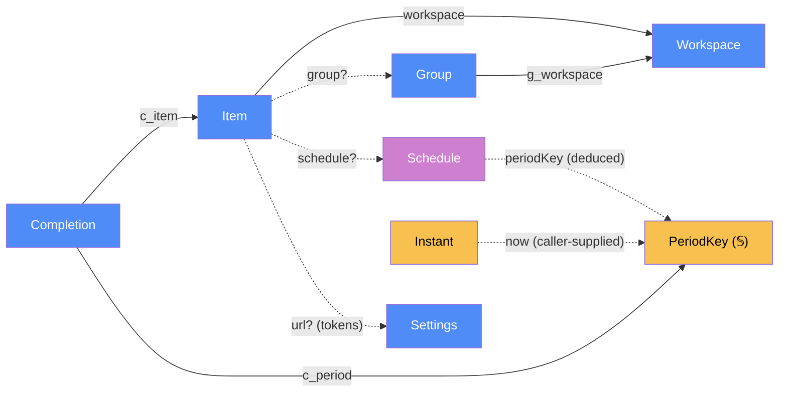

# Core — categorical model

> Model-first (FRAMEWORK §2/§4). Intended specification for `packages/core`: the pure,
> dependency-free logic shared by the Worker, the PWA and the desktop app. The code realises it
> (see IMPLEMENTATION.md). Source of record: `packages/core/*.js`.

## 1. Overview
`core` holds the data model and every pure transformation over it:
- schedule periods, and what is due, done or not due;
- URL token expansion;
- entity validation;
- ordering, sleep resolution and last-write-wins merging;
- the default seed dataset.

It has no I/O, no clock of its own (the caller passes `now`) and no dependencies.

## 2. Why
Three locations (Worker, desktop, phone) must agree exactly on "is this check-in due today?".
Putting `periodKey` in one pure module makes that agreement structural rather than tested-for:
- every placement runs the same arrow;
- a tick is stored against a `PeriodKey`, so "done" is deduced, never stored.

## 3. Core category

## 4. Morphism table
| Morphism | Signature | Partiality | Semantics |
|---|---|---|---|
| `workspace` | `Item → Workspace` | Total | owning workspace; moving an item changes only this |
| `group?` | `Item → Group` | Partial | section within the workspace; absent = ungrouped |
| `g_workspace` | `Group → Workspace` | Total | group's workspace; `group(i).g_workspace = workspace(i)` (rule 6) |
| `schedule?` | `Item → Schedule` | Partial | present ⇔ the item is a checklist entry (§3 consolidation) |
| `kind` | `Item → {web, app}` | Total | web = URL target; app = native exe |
| `url?` | `Item → 𝕊` | Partial | required when `kind = web`; may contain tokens |
| `appPath?` | `Item → 𝕊` | Partial | required when `kind = app` |
| `fallbackUrl?` | `Item → 𝕊` | Partial | used when the app is missing or on the phone |
| `devices` | `Item → {all, desktop, phone}` | Total | where the item is listed |
| `resetTime` | `Item → HH:MM` | Total | default `00:00`; the local time a period rolls over |
| `sleepAfterMin?` | `Item → ℕ` | Partial | absent = inherit the workspace value; `0` = never |
| `ws_sleepAfterMin` | `Workspace → ℕ` | Total | `0` = never (Productivity default `0`, others `10`) |
| `notify`, `badge`, `isolate`, `persistSessionCookies` | `Item → 𝔹` | Total | desktop behaviour toggles |
| `userAgent` | `Item → UserAgentPref` (`{preset: default│chrome│firefox│custom, custom: 𝕊?}`) | Total | desktop user-agent preset (D65/D70); absent = default; custom needs a non-empty string of at most 512 characters; `validateItem` enforces it, `userAgentOf` resolves it |
| `edge` | `Item → {inherit, never, always} × profile?` | Total | "open in Edge" preference |
| `order` | `Workspace/Group/Item → ℕ` | Total | dense 0..n-1 within its parent |
| `updatedAt` | `Entity → Instant` | Total | last-write-wins clock |
| `deleted` | `Entity → 𝔹` | Total | tombstone for sync |
| `c_item`, `c_period` | `Completion → Item`, `→ PeriodKey` | Total | one row per (item, period); `doneAt` is audit metadata |
| `periodKey` | `Schedule × Instant × Tz × ResetTime → PeriodKey?` | Deduced | ISO date of the current period start; `∅` before an everyNDays start date |
| `previousPeriodStart` | `Schedule × PeriodKey → PeriodKey?` | Deduced | the start of the period before the one starting at `periodKey`: the inverse of the next-period helper (daily −1 day, weekly −7, every-N-days −n, `∅` before the start date, monthly the previous month's clamped day); the Worker uses it to allow an untick of the previous period (`offline-ticks`) |
| `isDone` | `Item × Completion* × Instant → 𝔹` | Deduced | `∃ c : c_item = i ∧ c_period = periodKey(now)` |
| `bucket` | `Item × Completion* × Instant × Tz → {due, done, notDue}` | Deduced | see rule 4 |
| `nextDue` | `Item × Completion* × Instant × Tz → Date` | Deduced | start of the next period that is not done |
| `expandUrl` | `𝕊 × Instant × Tz × Settings → 𝕊 × UnknownToken*` | Deduced | rule 5 |
| `ws_ungroupedLabel` | `Workspace → 𝕊?` | Total | optional name (at most 40 characters, non-blank) of the section holding items without a group (D99); absent = "Default" (`ungroupedLabelOf`); `validateWorkspace` enforces it |
| `ws_openInEdge` | `Workspace → 𝔹` | Total | default "open in Edge" for items whose Edge mode is `inherit` |
| `effectiveSleep` | `Item × Workspace → ℕ` | Deduced | `sleepAfterMin?(i) ?? ws_sleepAfterMin(workspace(i))` |
| `effectiveEdge` | `Item × Workspace × Profile? → 𝔹 × Profile?` | Deduced | D17: `always` opens, `never` does not, `inherit` follows `ws_openInEdge`; profile = item profile, else the device default, else none |
| `validateWorkspace` | `Workspace → Error*` | Total | non-blank name; `ungroupedLabel` non-blank and at most 40 characters when set; the server runs it on every merged live workspace |
| `ungroupedLabelOf` | `Workspace → 𝕊` | Deduced | the trimmed label, else "Default" |
| `userAgentOf` | `Item → UserAgentPref` | Deduced | an item without `userAgent` (or an unusable one) is `{preset:'default', custom:null}` |
| `moveItem` | `Item × WorkspaceId × Instant → Item` | Total | keeps id and history, clears `group?`, bumps `updatedAt`; leaves `order` to `reorder` |
| `validateItem` | `Item → Error*` | Total | empty list = valid |
| `removalPlan` | `Snapshot × Kind × Id × Instant → {changed} ⊕ {error}` | Total, deduced | deletion rules shared by the desktop and the phone: item → tombstone; group → tombstone, its live items ungrouped; workspace → it, its groups and items tombstoned, refused for the last live workspace; unknown or already-deleted → `not-found`; every changed entity stamped with the deletion time |
| `reorder` | `Entity* × id × ℕ → Entity*` | Total | move one entity, re-densify `order`, bump `updatedAt` of the changed entities |
| `mergeLww` | `Entity* × Entity* → Entity*` | Total | per id keep the greater `updatedAt`; ties broken by the greater canonical JSON (keys sorted) (rule 7) |

## 5. Functors
**Schedule → period.** For effective local date `d = localDate(now − resetTime, tz)`:

| Schedule | Period start (= `periodKey`) |
|---|---|
| `daily` | `d` |
| `weekly(w)` (ISO weekday 1=Mon…7=Sun) | the latest date `≤ d` whose weekday is `w` |
| `monthly(m)` (1…31) | `clamp(m)` in d's month if `d ≥` it; otherwise `clamp(m)` in the previous month. `clamp` = `min(m, daysInMonth)`. |
| `everyNDays(n, s)` | `∅` if `d < s`; else `s + n·⌊(d − s)/n⌋` |

## 6. Composition rules
1. `deduction: isDone(i, now) ⇔ (i, periodKey(schedule(i), now, tz, resetTime(i))) ∈ Completion*`.
   Done is never stored.
2. `constraint: tick` is idempotent per `(itemId, periodKey)`: the pair is unique.
3. `constraint: periodKey(now)` is monotone non-decreasing in `now` (fixed tz).
   A period never "un-starts".
4. **`deduction: bucket`.** Let `dayKey = localDate(now − resetTime, tz)`.
   - `notDue` if `periodKey = ∅` (an everyNDays item before its start date), or if the item is
     done and its completion's `dayKey(doneAt) ≠ dayKey(now)`.
   - otherwise `done` if it is done;
   - otherwise `due`.
   - Items without a schedule have no bucket.
   - Effect: a weekly item ticked on Monday shows as done on Monday, then sits in "Not due" until
     its next period.
5. **`deduction: expandUrl`.** Tokens `{YYYY}`, `{MM}`, `{DD}` are filled from
   `localDate(now, tz)`, ignoring `resetTime`; `{googleEmail}` comes from Settings.
   - An unknown token is left verbatim and reported.
   - `{googleEmail}` with no setting is also reported.
6. `invariant: group?(i)` defined ⇒ `g_workspace(group(i)) = workspace(i)`.
   Moving an item across workspaces clears `group?`.
7. `constraint: mergeLww` is commutative, associative and idempotent (a join-semilattice on
   `(updatedAt, canonical JSON)`), so sync order does not matter. Per id the greater `updatedAt`
   wins; ties go to the greater canonical JSON (keys sorted). Tombstones win only by `updatedAt`.
8. **`constraint: validateItem` rejects:**
   - `kind=web` without an http(s) `url`;
   - `kind=app` without an `appPath`;
   - a non-http(s) `fallbackUrl`;
   - a malformed `resetTime`;
   - `weekly` outside 1–7, `monthly` outside 1–31, `everyNDays` with `n < 1` or an invalid start date;
   - `sleepAfterMin < 0`;
   - unknown tokens in `url` or `fallbackUrl`.

## 7. Atoms owned (FRAMEWORK §4)
**Trn**
| `Trn` | t_from → t_to | Realising code |
|---|---|---|
| `periodKey` | `Schedule × Instant × Tz × ResetTime → PeriodKey?` | `packages/core/schedule.js:periodKey` |
| `previousPeriodStart` | `Schedule × PeriodKey → PeriodKey?` | `packages/core/schedule.js:previousPeriodStart` |
| `bucket` | `Item × Completion* × Instant × Tz → Bucket?` | `packages/core/schedule.js:bucket` |
| `nextDue` | `Item × Completion* × Instant × Tz → Date?` | `packages/core/schedule.js:nextDue` |
| `expandUrl` | `𝕊 × Instant × Tz × Settings → {url, unknown}` | `packages/core/url-tokens.js:expandUrl` |
| `validateItem` | `Item → Error*` | `packages/core/model.js:validateItem` |
| `effectiveSleep` | `Item × Workspace → ℕ` | `packages/core/model.js:effectiveSleep` |
| `effectiveEdge` | `Item × Workspace × Profile? → 𝔹 × Profile?` | `packages/core/model.js:effectiveEdge` |
| `userAgentOf` | `Item → UserAgentPref` | `packages/core/model.js:userAgentOf` |
| `moveItem` | `Item × WorkspaceId × Instant → Item` | `packages/core/model.js:moveItem` |
| `removalPlan` | `Snapshot × Kind × Id × Instant → {changed} ⊕ {error}` | `packages/core/removal.js:removalPlan` |
| `reorder` | `Entity* × id × ℕ × Instant → Entity*` | `packages/core/order.js:reorder` |
| `mergeLww` | `Entity* × Entity* → Entity*` | `packages/core/sync.js:mergeLww` |

**Loc** — collapsed. Pure code runs in-process wherever it is imported (§7.1 degenerate case).
It is placed at L-edgeW, L-desk and L-phone (see architecture-map §4).

**Trm** — none. Every handoff happens in the same location, so each is a `Trn`.

## 8. Bridges to other components (ports)
| Boundary morphism | Signature | Stored? | Semantics |
|---|---|---|---|
| `schemaShape` | `core.Item → web.items row` | Stored (D1) | the D1 columns mirror the `Item` fields 1:1 |
| `seed` | `() → (Workspace, Group, Item)*` | Stored once | the example dataset (11 items; D54). The user's real list is the git-ignored `config/seed.local.json`; web seeds D1 from it via `scripts/gen-seed-sql.mjs`, not via a migration (D55) |

## 9. Coherence notes
- **Law 6:** `core` is the multi-placement case. Its purity is what makes the multiple placements safe.
- **Law 1:** every input (`now`, `tz`, `Completion*`) is an argument, so the module never reads ambient state.
