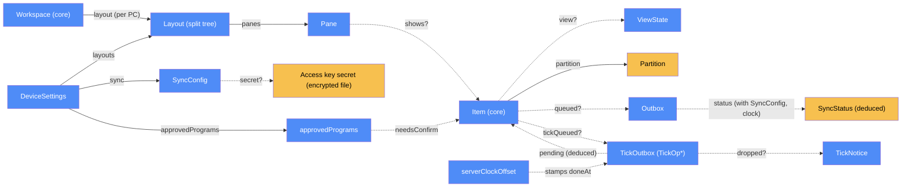

# Desktop — categorical model

> Model-first (FRAMEWORK §2/§4). Intended specification for `apps/desktop`: the portable
> Electron app. The code realises it (see IMPLEMENTATION.md). Source of record:
> `apps/desktop/**` (the local shell is built by change `desktop-shell`, polished by `desktop-polish`;
> sync with the Worker is built by change `desktop-sync`).

## 1. Overview
Fruitery's Windows app, with three columns:
- a thin workspace **rail** (Ctrl+1..9 switches workspace);
- the active workspace's **item list** (groups, ticks, "Not due");
- a **pane area** holding 1–4 split panes, each showing one item's live web view.

Other behaviour:
- Sites keep their state across workspace switches. A view is unloaded only by its sleep timer.
- Logins live in persistent Electron partitions under `<exeDir>\data`.
- The app syncs workspaces, items, settings and ticks with the web component (`desktop-sync`). A PC
  connects with its own Cloudflare Access service token; everything lives in a local `cache.json` in the
  API snapshot shape, with the unconfirmed local edits queued beside it. A PC that is not configured stays
  purely local.
- Closing the window hides it to the tray, and the app starts with Windows.

## 2. Why
The desktop straddles four locations: main process, UI renderer, one sandboxed renderer per
site, and the OS/Edge. Modeling those as `Loc`s, with the IPC bridge as the only `Trm` between
UI and main, makes the security rule checkable: remote sites get **no** `Trm` to main. The
`ViewState` object makes "sleep" a transformation with an explicit inverse (`wakeView`), rather
than a reload that loses state.

## 3. Core category

## 4. Morphism table
| Morphism | Signature | Partiality | Semantics |
|---|---|---|---|
| `layout` | `Workspace → Layout` | Total | split tree of 1–4 panes, stored per PC in `DeviceSettings.layouts` (Q52) |
| `panes` | `Layout → Pane*` | Total | leaves of the split tree, with ratios |
| `shows?` | `Pane → Item` | Partial | an empty pane shows a picker; **an item appears in at most one pane per layout** |
| `view?` | `Item → ViewState` | Partial | live view exists ⇔ awake; `{lastUrl, scrollY, hiddenSince?}` survives sleep |
| `partition` | `Item → 𝕊` | Deduced | `isolate ? "persist:fruitery-<id>" : "persist:fruitery"` (the API is reached with service-token headers, not a browser session: D103) |
| `userAgent` | `Item → {default, chrome, firefox} ⊕ 𝕊` | Total | the UA preset for the item's view and popups; `default` = Electron's own UA (D65); core `userAgentOf` resolves it (absent = default) |
| `focusedPane` | `Layout → Pane` | Total | list clicks open into it; changed by pane id only (`focusPane`), checked against the stored layout (rule 32) |
| `activeItem` | `Workspace → Item?` | Partial | remembered per PC; restored on switch |
| `iconOf` | `Item → PNG?` | Partial | the site's icon captured when the item's own site loads (`<exeDir>\data\icons`, per PC, not synced); the list shows typed icon, else this, else the first letter (D116) |
| `navigateTo` | `Item × 𝕊 → ViewState` | Partial | a typed address loaded in the item's own view (http(s) only); the saved address is unchanged (D120) |
| `sync` | `DeviceSettings → SyncConfig` | Total | `{baseUrl, clientId, expiresOn}`, all possibly null; per PC, never synced (D39); the secret is not part of it |
| `secret?` | `SyncConfig → 𝕊` | Partial | the client secret, in `<exeDir>\data\sync-secret.bin` encrypted for the Windows user; undefined when absent, unreadable or copied to another user; read only in main (rule 18) |
| `queued?` | `Entity → OutboxEntry` | Partial | an edited workspace, group, item or settings that the Worker has not confirmed; one entry per (kind, id), the newest version; `error?` holds the server's field errors |
| `tickQueued?` | `Item × Period → TickOp` | Partial | a tick or untick made without a connection and not yet sent; one op per (item, period); `{op:'tick', itemId, doneAt, periodKey}` or `{op:'untick', itemId, periodKey}`; at most 500 (D147, D153) |
| `pending` | `Item × Period → 𝔹` | Deduced | a completion is pending iff a `tick` op exists for it (a removal iff an `untick` op); never stored (rule 34) |
| `dropped?` | `TickOp → TickNotice` | Partial | a queued tick the server refused for good (too old, from the future, period not allowed): `{id, itemId, name, periodKey, reason, at}`, at most 20, shown in Needs attention with Dismiss (rule 38) |
| `stamps` | `serverClockOffset × Instant → Instant` | Total | a queued tick's `doneAt` is `localNow + (serverNow − localNow at the last pull)`; 0 before the first pull (D150, rule 37) |
| `status` | `SyncConfig × Outbox × SyncState × Instant → SyncStatus` | Deduced | `not-connected`, `expired`, `error:<reason>`, `offline`, `expiring:<days>`, `syncing` or `synced`; never stored (rule 28) |
| `approvedPrograms` | `DeviceSettings → 𝕊*` | Total | program paths the owner allowed to start on this PC; per PC, never synced (D89) |
| `needsConfirm` | `Path × 𝕊* → 𝔹` | Total | true unless the normalised path (case and slash insensitive) is approved; drives the "Start this program?" question (rule 31) |

## 5. Functors
**View lifecycle (state machine → poset `absent < awake-hidden < awake-shown`).**
- `wakeView`: `absent → awake` creates a WebContentsView at `lastUrl ?? expandUrl(url)` and
  restores `scrollY` after load (best-effort).
- `sleepView`: `awake-hidden → absent` fires when `now − hiddenSince ≥ effectiveSleep(item)` and
  `effectiveSleep > 0`. It saves `lastUrl` and `scrollY` first.
- A shown view never sleeps.

## 6. Composition rules
1. `invariant:` workspace switches only re-attach views. They never reload or navigate them (Q50).
2. `invariant:` `sleepView` applies only while hidden. The timer uses `core.effectiveSleep`, i.e.
   the item's own workspace default even when the item is shown in another workspace's split.
3. `constraint:` remote site renderers have `contextIsolation`, `sandbox` and no preload. Only
   the UI renderer gets `preload.js`.
4. **`constraint: persistSessionCookies`.**
   - On `session.cookies 'changed'`, every cookie without an expiry, in a partition whose
     item(s) allow persistence, is re-set with `expirationDate = now + 30d`.
   - The re-set keeps `httpOnly`, `secure`, `sameSite` and `path`. It omits `domain` for host-only
     cookies and for `__Host-` cookies.
   - `flushStore()` runs afterwards.
   - This does not depend on quit events (a reboot from the tray must not lose logins).
5. `constraint:` `paths.js` is the first import of `main.js` and calls `app.setPath` (appData,
   userData, sessionData, logs, crashDumps → `<exeDir>\data`, Chromium's profile in `data\profile`)
   as an import-time side effect, before any session exists (ESM hoists imports, so statements
   after the imports would be too late). Nothing is written to `%APPDATA%`/`%LOCALAPPDATA%` (Q38).
6. **`deduction: openItem`.**
   - `kind=app` with an existing `appPath` → `shell.openPath`.
   - Otherwise a URL with a missing placeholder (Google email) or an unknown token is *blocked*
     and the owner is told what to set.
   - Otherwise, if the item's Edge preference applies → `msedge [--profile-directory=
] <url>`
     (item profile, else the device profile, else none), spawned without a shell.
   - Otherwise (including a native app whose program is missing: its fallback URL) the item opens
     in the focused pane.
7. `constraint:` the Daily bar never asks (D119, which supersedes the D8 "Done?" prompt): **Done** ticks and shows the next due item, **Next** shows it without ticking, and workspace or item switches never ask either.
8. `deduction: deriveBadge(title) = n` when the title matches `^\((\d+)\)`, else `∅` (best-effort,
   no per-site recipes).
9. `constraint:` an item's UA is applied before its view's first load and never changes while the view lives; changing the preset takes effect on the next wake/reload (D65). A popup of an item with a non-default preset gets the same UA (a default-preset popup is left exactly as the spike verified it: no override, no debugger, client hints intact): its first request is rewritten in the session (`onBeforeSendHeaders`) and its page identity is set through the DevTools emulation override, because `setUserAgent` alone does not reach a popup's first document.
10. `constraint:` native site views paint above the UI's DOM, so while an HTML dialog, an item drag or a divider drag is active every view is detached from the window (`setOverlay`) and re-attached afterwards. Detaching is not hiding: nothing reloads and no sleep timer starts. The delete confirmation uses a native message box, which is above the views anyway; toasts sit beside the item list for the same reason.
11. `constraint:` every IPC handler validates its arguments and answers only the UI window's own top frame; a window a site opens is routed by `routePopup`: a sign-in arriving as a new tab (known identity host, auth-looking URL, or same-site as the opener) → loads in the opener's own pane (`same-pane`); a `new-window` popup or a blank window → app window in the item's partition and UA (a closed sign-in popup reloads an opener that did not move); any other new tab → default browser; non-http(s) → denied.
12. `deduction: partitionOf` (`persist:fruitery` shared, `persist:fruitery-<id>` isolated) and the cookie opt-out set (hosts of opted-out non-isolated items, `www.` stripped, suffix match; an isolated partition is opted out as a whole by its item's flag). A cookie scoped to a *parent* domain of an opted-out host is not covered.
13. `constraint:` (D118) page navigation keys act on the page that has focus: F5 reload, F6 the item's saved address, Alt+Left / Alt+Right back / forward. A key pressed in a site acts on that site's own item; a key pressed in the app, and the window's `app-command` events (mouse side buttons, keyboard browser keys), act on the focused pane. The hardware keys exist only as `app-command`, so one press is one step.
14. `constraint:` (D120) the pane title shows the page title; one click copies the address, a double click edits it, Enter loads it in the same view (http(s) only, the saved address of the item never changes). The click state and the typed text live in the UI state, not in the pane header, which is rebuilt on every state change.
15. `constraint:` (D121) the address a page action copies or opens is read from the view in the main process, never sent by the UI; "open in Edge" uses the item's profile, else this PC's. The page's right-click menu acts on the webContents that raised it.
16. `deduction: iconOf` (D116): a typed emoji or letter, else the site icon cached per PC in `data\icons`, else the first letter. The icon is captured only when a page of the item's own site loads (never for a sign-in provider's page, never in the background); a one-off "Refresh icon" in the editor fetches it on request. Downloads use the item's session, a 5 s timeout and a 256 KB cap enforced while reading; an id never chooses the file path.
17. `constraint:` (D117, D119) the Daily bar never asks: Done ticks and shows the next due item (list order of the item's workspace), Next shows it without ticking. After an item is opened in Edge or as a program and the window is left and re-entered, the UI offers "Done with <name>?" for a scheduled item that is still due.
18. `constraint:` (D103, D111) the access key's secret exists only in the main process: encrypted with `safeStorage` in `<exeDir>\data\sync-secret.bin`, read per request, never in an IPC result, a state broadcast, `device.json` or a log. The UI learns `configured`, `connected`, the last 4 characters of the client id, the address and the expiry. A copy of the data folder on another PC or Windows user cannot decrypt it, which reads as "no secret": the app asks for the key again and does not sync.
19. `constraint:` (D103) the key goes only to the configured address, over `https://` (plain http to `127.0.0.1`, `localhost` or `[::1]` only in smoke or development), only in the `CF-Access-Client-Id` / `CF-Access-Client-Secret` headers. Redirects are never followed: a redirect means Access refused the key. Every request times out after 15 s. Nothing in a result or log carries the secret or the full client id (D114, D115: the Worker, not the desktop, checks the id against its list).
20. `constraint:` connection settings: a blank client id or secret keeps the stored one; a new address or client id needs the secret typed again (`retype-required`); the expiry date is optional; Test connection saves dirty fields first; Disconnect deletes the secret, clears the client id and expiry and keeps the address.
21. `invariant:` while an address and a client id are set, every local edit (upsert, remove via `removalPlan`, reorder, moveItem, settings) queues exactly the entities it replaced, one entry per (kind, id), the newest version; an invalid edit queues nothing; device settings are never queued. A PC with nothing configured (local-only mode) makes no request, starts no timer and grows no outbox.
22. `constraint:` one sync flight at a time; a trigger during a flight asks for exactly one more run. Triggers: start, window focus, every 60 s, a 1 s debounce after an edit. A flight pushes the outbox first (at most 100 entities per request, workspaces and groups before items), then sends the queued ticks (rule 35), then pulls `/api/state` and merges it. An edit made while a request is in flight is kept.
23. `deduction: planSync` (D79, Law 6): per kind, the server's entities are the base and an outbox entity replaces its remote version only when it wins under core `mergeLww` (newer `updatedAt`, core's tie-break); tombstones are ordinary versions in both directions; completions come from the server only; local entities that are neither on the server nor queued are dropped once synced. Whole-entity last-write-wins: a concurrent edit to one item loses one side (D79).
24. `constraint:` a network failure keeps the outbox and shows `offline`; an auth failure shows `error:<reason>` (the Worker's reason code) and stops the flight; both clear on the next good flight. The local cache stays usable throughout.
25. `constraint:` a change the server rejects (422) stays local, is marked with the field errors and shown under "Needs attention"; the other entries of the batch still go through and the pull still happens. Discard drops only a rejected entry and re-pulls, so the server's version replaces it. A 400, or an answer that confirms nothing, never loops.
26. `constraint:` first connect to an address (owner decision 2026-10-20: keep newer local edits): back up the cache as `cache.pre-sync-<time>.json`, queue the local entities that are newer than the server's (never untouched seed rows), push them, send the current-period ticks, then use the server's history. The marker `firstSyncDoneFor` is set only after a fully successful flight; a different address starts over.
27. `constraint:` (Law 1, refined by `offline-ticks`; D41, D147, D148) the server decides the period. A connected tick goes through `POST /api/ticks` / `DELETE /api/ticks/{id}` without a time, so the Worker's clock decides. A tick made without a connection (offline, or in a sync error, or after a direct request failed on the connection) is applied to the local completions at once, shown as pending, queued with the time it was made on the server's clock as last seen, and sent later: the Worker bounds that time to [now − 48 h, now + 5 min] and maps it to a period with its stored timezone and the item's reset time. Only an expired key or an unreadable key refuses (`ticks-need-connection`, nothing changes), because no key could ever send the tick; the UI shows a notice only then. Only a PC with nothing configured ticks locally. This supersedes D27 for the desktop; the phone stays online-only.
28. `deduction: statusOf`: `not-connected` beats everything; otherwise `expired` (today is after the expiry date) > `error:<reason>` > `offline` > `expiring:<days>` (0 to 14 whole days in the configured timezone) > `syncing` > `synced`. It is computed from the in-memory sync state and the clock, never stored. The chip shows a flight only after 500 ms, so a short one does not flicker.
29. `constraint:` Disconnect resets the first-sync marker and empties the entity queue, the tick queue and the tick notices. The edits and the local completions stay in the local data and the next first connect finds them again, because they are newer than the server's copy.
30. `constraint:` (Law 4) the desktop reaches D1 only through `t_api_desk`; the Worker validates every entity again (`validateItem`).
31. `constraint:` (D89) an item that would start a program never approved on this PC first asks "Start this program?" with the full path. Start remembers the exact path (case and slash insensitive) in `approvedPrograms`; Don't start (also Esc) opens the item's fallback address in a pane, else nothing. A missing program and an open in a split never ask or launch. The approved list is per PC, never synced and not editable from the UI.
32. `constraint:` (D131, D145) a focus change never carries a layout tree: the UI sends only `focusPane(workspaceId, paneId)` and main checks the pane against the layout it stores itself (a leaf of it; the single pane `p1` when none is stored), changing nothing else; when a site view gains focus main sets the focus itself before telling the UI. Only real tree edits (split, drop, close, resize) send a tree through `setLayout`. The UI's copy of the tree can therefore never undo a layout change made in main.
33. `constraint:` (D147) a tick or untick made without a connection is applied to the local completions at once (time = local clock + `serverClockOffset`, period = the local `periodKey` with the synced timezone) and queued as a `TickOp`; the answers keep the local tick''s codes plus `pending`; the queue holds at most 500 ops, one per (item, period).
34. `deduction: pending` (D153): a local completion is pending iff a `tick` op for its (item, period) is queued; never stored. A second tick changes nothing; a tick and an untick of one period cancel out; a pull keeps a waiting tick the server lacks and hides a completion a waiting untick removes; a sent tick is no longer pending. Known narrow race, accepted: an untick made while that tick''s own request is in flight shows the tick again after the next pull.
35. `constraint:` the flight order is push entities → send ticks → pull (entities first, so an item made offline exists before its tick arrives). Ticks go one request at a time in queue order. Success removes the op; a 422 (`tick-too-old`, `tick-in-future`, `period-not-allowed`, or any other 422) or a 400 drops it with a `TickNotice` and removes a tick''s local completion; 404 and 409 drop it silently; offline, denied or refused stop the queue and keep it; a 5xx stops it with `http-<status>` but the pull still runs.
36. `constraint:` (D152) capability gate: queued ticks are sent only to a Worker whose latest `GET /api/state` lists `tick-done-at` (read once when the session has not pulled yet). Without it the queue is held (nothing sent, nothing dropped) and Needs attention says "Queued ticks wait for a Worker update (npm run deploy:web)"; the next pull that carries the flag releases it. Direct online ticks never wait for the flag, so the deploy order does not matter.
37. `constraint:` (D150) the time a queued tick carries is the PC clock moved by `serverNow − localNow` seen at the last pull (changes under 2 s ignored; 0 before the first pull), so a PC whose clock is minutes ahead is not refused as "from the future".
38. `constraint:` (D151) `tickOutbox` (500 ops), `tickNotices` (20, oldest out) and `serverClockOffset` live in `cache.json`; a missing, old or damaged value loads empty (offset 0). Dropped ticks are listed in Needs attention with Dismiss and counted on the chip badge; a toast would never be seen while the app sits hidden in the tray.

## 7. Atoms owned (FRAMEWORK §4)
**Trn**
| `Trn` | t_from → t_to | Realising code |
|---|---|---|
| `wakeView` / `sleepView` | `ViewState → ViewState` ⊸ | `apps/desktop/main/views.js:createViews`; which views are due: `apps/desktop/lib/sleep.js:dueToSleep` |
| `applyLayout` | `Layout × Rect → PaneRect*` | `apps/desktop/lib/layout.js:rects` (the UI reports the boxes; `apps/desktop/main/views.js:createViews` places the views) |
| `persistSessionCookies` | `Cookie → Cookie` ⊸ | `apps/desktop/lib/cookie-transform.js:toPersistentDetails`, hooked in `apps/desktop/main/sessions.js:createSessions` |
| `openItem` | `Item → effect` ⊸ | decision `apps/desktop/lib/resolve-open.js:resolveOpen`, effects `apps/desktop/main/open.js:createOpener` |
| `deriveBadge` | `𝕊 → ℕ?` | `apps/desktop/lib/badge.js:deriveBadge` |
| `userAgentFor` | `Preset × 𝕊? × 𝕊 → 𝕊` | `apps/desktop/lib/ua.js:userAgentFor` |
| `captureIcon` | `PageIcons × Item → PNG?` ⊸ | `apps/desktop/main/icons.js:createIcons`; the own-site rule `apps/desktop/lib/favicon.js:isOwnSite`, the bounded download `apps/desktop/main/icon-fetch.js:fetchLimited`, decoding `apps/desktop/main/icon-convert.js:createConverter` |
| `normalizeAddress` | `𝕊 → URL ⊕ Error` | `apps/desktop/lib/address.js:normalizeAddress` |
| `selectSeed` | `𝕊? × Seed → Seed` | `apps/desktop/lib/seed-select.js:selectSeed` |
| `planSync` | `Local × Remote × Outbox → {merged, outboxRemaining}` | `apps/desktop/lib/sync-plan.js:mergeSnapshot`, `apps/desktop/lib/sync-plan.js:afterPush`, `apps/desktop/lib/sync-plan.js:firstSyncPlan` |
| `pushOutbox` | `Outbox ⊸ Outbox` (batches of at most 100, `PUT /api/entities`) | `apps/desktop/main/sync.js:createSync` |
| `pull` | `Snapshot ⊸ cache` (`GET /api/state`, then `applyRemote`) | `apps/desktop/main/sync.js:createSync`, `apps/desktop/main/store.js:applyRemote` |
| `tickRemote` | `ItemId ⊸ Completion?` (direct `POST` / `DELETE /api/ticks`, or queued locally when there is no connection) | `apps/desktop/main/sync.js:createSync` (tick, untick), `apps/desktop/main/store.js:queueTick`, `apps/desktop/main/store.js:queueUntick` |
| `enqueueTick` / `applyTickOps` | `TickOp* × TickOp → TickOp*`; `Completion* × TickOp* → Completion*` | `apps/desktop/lib/sync-plan.js:enqueueTick`, `apps/desktop/lib/sync-plan.js:applyTickOps` |
| `sendTicks` | `TickOp* ⊸ TickOp*` (gated on the Worker's `tick-done-at`; outcomes by `afterTickSend`) | `apps/desktop/main/sync.js:createSync` (sendTicks), `apps/desktop/lib/sync-plan.js:afterTickSend`, `apps/desktop/lib/sync-plan.js:hasTickFeature` |
| `statusOf` | `SyncState × Instant → SyncStatus` | `apps/desktop/lib/sync-plan.js:statusOf` |
| `requestApi` | `Key × Request ⊸ ApiResult` | `apps/desktop/main/sync-http.js:createRequestApi`, `apps/desktop/lib/sync-config.js:classifyResponse` |
| `saveSecret` / `loadSecret` | `𝕊 ⊸ bytes`, `bytes → 𝕊?` | `apps/desktop/main/secrets.js:createSecrets` |
| `configureSync` | `Form → SyncConfig × 𝕊?` | `apps/desktop/lib/sync-config.js:planConfigure`, `apps/desktop/main/sync-settings.js:createSyncSettings` |
| `needsConfirm` | `Path × 𝕊* → 𝔹` | `apps/desktop/lib/program-approval.js:needsConfirm` |

**Loc**
- `L-desk.main`: the main process.
- `L-desk.ui`: the app-UI renderer.
- `L-desk.site[i]`: one sandboxed renderer per awake item.
- `L-desk.disk`: `<exeDir>\data` (partitions, cache.json with the outbox, device.json, `sync-secret.bin`, icons, `cache.pre-sync-<time>.json`).
- `L-edgeW`: the Worker (owned by `web`); the only thing the desktop's sync talks to.

**Trm**
- `t_ipc`: UI ⇄ main via preload. It carries `Command`s and state snapshots.
- `t_api_desk`: main → web over HTTPS, using Electron `net.fetch` with the `CF-Access-Client-Id` / `CF-Access-Client-Secret` headers of the PC's own service token (D103); no browser session, no redirect followed. It carries `Command/Query ⇄ Entity*, Completion*`; the reply is paired.
- `t_edge`: main → Edge (child_process).
- `t_launch`: main → OS (shell).

**Placements (§4.2)**
- `bucket` and `validateItem` run in `L-desk.ui` (via `core`) and in `web`.
- `Item` has two `DataLoc`s here: the cache file and UI memory.
- `mergeLww` runs in `L-desk.main` (`planSync`) and in `L-edgeW` (the upsert); `validateItem` runs in `L-desk.main`, `L-desk.ui` and `L-edgeW`. One pure module (`packages/core`) serves every placement (Law 6).
- The key's secret has exactly one `DataLoc`: `L-desk.disk` (encrypted), read in `L-desk.main`; there is no `Trm` that carries it to `L-desk.ui`.

## 8. Bridges to other components (ports)
| Boundary morphism | Signature | Stored? | Semantics |
|---|---|---|---|
| `api` | `desktop → web` | cache.json (copy) + `outbox` (unconfirmed edits) | the same API as the PWA, reached with the PC's service token; the cache is merged with `core.mergeLww` (`planSync`); ticks go through the API only |
| `core` import | `desktop → core` | — | the UI renderer and main import `packages/core` |

## 8b. The IPC contract (`t_ipc`)
`window.fruitery` (`apps/desktop/preload.cjs`) is the only bridge; handlers are in
`apps/desktop/main/ipc.js:createApi`.
- **State:** `getState()` → `{snapshot, device, viewStates, badges, iconRevs, now, meta, sync, ticksEnabled, pendingTickItems}`; main pushes the same
  shape with `onState` after every change. `device` leaves out the `sync` key and `sync` is the status object without the secret
  or the full client id (rule 18). `onCommand` (context-menu commands, focus) and
  `onShortcut` (Ctrl+1..9, Ctrl+Tab, F3 and the navigation keys) are main → UI; `onCommand` also carries `done-prompt`.
- **Views:** `show(itemId, paneId?, {split?})`, `setLayout` (tree edits), `focusPane(workspaceId, paneId)` (ids only, D131), `setPaneRects`, `selectWorkspace`,
  `navigate`, `setOverlay`.
- **Ticks and edits:** `tick`, `untick`, `upsert`, `reorder`, `moveItem`, `remove`, `saveSettings`,
  `saveDevice`.
- **Effects:** `openInEdge`, `contextMenu(kind, id)`, `confirm`, `pickProgram`, `copyAddress`, `openPageInEdge`, `navigateTo`.
- **Icons:** `getIcon(itemId)` (a data URL), `refreshIcon(itemId)`; the state carries only `iconRevs` (a revision per item).
- **Sync:** `syncStatus()` → `{configured, connected, status, baseUrl, clientIdTail, expiresOn, lastSyncAt, pending, rejected, droppedTicks, ticksHeld, ticksEnabled}` (`pending` counts queued ticks too);
  `syncConfigure({baseUrl, clientId, secret, expiresOn})` → `{ok}` or `{ok: false, errors: [{field, code}]}` (the only call that carries the secret, inward);
  `syncTest()` → `{ok}` or `{ok: false, reason}`; `syncDisconnect()`; `syncDiscard(kind, id)`; `syncDismissTickNotice(id)`. `tick` / `untick` go through the sync engine and may answer `pending: true`; the state also carries `pendingTickItems` (item ids with a queued op).
  `saveDevice` still accepts only `edgeProfile`, `autostart` and `listWidth`: `sync` and `approvedPrograms` cannot be set from the UI.

## 9. Coherence notes
- **Law 4 / security:** `L-desk.site[i]` has no `Trm` to `L-desk.main`.
- **Law 1:** offline start renders the config from cache, but ticks require `t_api_desk`
  (Q26), so a cached completion is never authoritative. A tick
  made without a connection is queued, not refused (rule 27, D147): the completion is pending (deduced from the queue), and the
  Worker decides the period from the reported time, bounded by its own clock (`docs/web/ARCHITECTURE.md` rule 13); only an
  expired or unreadable key refuses ticking.
- **Law 4:** `L-desk` reaches `L-db` only through `t_api_desk` → `L-edgeW`; no D1 access from the desktop.
- **Law 6:** `mergeLww` and `validateItem` from `packages/core` run on the desktop and in the Worker; the desktop never
  invents its own merge or validation.
- **Note (rule 23):** the merge is whole-entity last-write-wins (D79); a concurrent edit to one item loses one side.
- **Open questions:**
  - Spikes (a) and (b) are done: see [general/spike-electron.md](general/spike-electron.md) (Electron's default UA passed Google sign-in, D65; an abrupt-shutdown test is D66).
  - Badges on sites without a title count.
  - Google sign-in with the default UA and the End-task test (D66) are manual checks, see [general/manual-checks.md](general/manual-checks.md).
  - The desktop's Access login is settled (D103): a per-PC service token, no embedded Google sign-in. The setup is in [general/sync-setup.md](general/sync-setup.md); the real two-PC and phone check is in [general/manual-checks.md](general/manual-checks.md) (section 11).
  - The `ctx.access` service-identity field names in the Worker are unverified against the real deployment (see `docs/web/general/service-tokens.md`).
