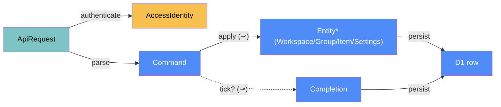

# Web — categorical model

> Model-first (FRAMEWORK §2/§4). Intended specification for `apps/web`: a Cloudflare Worker
> that serves the PWA and the `/api`, backed by D1 and gated by Cloudflare Access. The code
> realises it (see IMPLEMENTATION.md). Source of record: `apps/web/**` (built by change `web-checklist`).

## 1. Overview
The authoritative home of every synced object (`Workspace`, `Group`, `Item`, `Completion`,
`Settings`; shapes in [core/ARCHITECTURE.md](../core/ARCHITECTURE.md)). It also serves the
installable checklist PWA used on the Android phone. The desktop app is a second API client. The Worker is named `fruitery` (`fruitery.<subdomain>.workers.dev`).

## 2. Why
This is a client–server component (FRAMEWORK §7.2):
- D1 holds the only authoritative `DataLoc`. The desktop and phone hold copies.
- **`tick` is placed only here**, so the server decides `periodKey`. Client clock skew
  therefore cannot create a tick in the wrong period (Law 1: `now` is materialised at L-edgeW). Since `offline-ticks` a
  client may *report* when it made a tick (`doneAt`), but the server first bounds that instant with its own clock
  (at most 48 h back, 5 min ahead) and then maps it with its stored timezone and the item's reset time; a client can
  never choose the period directly.

## 3. Core category

## 4. Morphism table
| Morphism | Signature | Partiality | Semantics |
|---|---|---|---|
| `authenticate` | `ApiRequest → AccessIdentity` | Partial | identity from Access whose email is one of the owner addresses (`OWNER_EMAIL`, comma-separated, case-insensitive), otherwise 403 `{error:'forbidden', reason}` where `reason` is a code only (`no-credentials`, `jwt-config-missing`, `jwt-malformed`, `jwt-unknown-key`, `jwt-bad-signature`, `jwt-expired`, `jwt-not-yet-valid`, `jwt-wrong-issuer`, `jwt-wrong-audience`, `email-mismatch`, `owner-email-missing`, `access-identity-error`, `access-no-email`) and one `auth denied` log line carries the reason and the path (`jwt`, `ctx.access`, `none`), never an email, token, AUD or domain. Order: (1) local dev bypass (rule 5); (2) if the `Cf-Access-Jwt-Assertion` header is present, validate it (iss/aud/exp checked) and stop there: a present-but-invalid header is 403, never a fall-through; (3) else if the Worker-level Access binding `ctx.access` exists, `getIdentity().email` must be the owner (an error or missing identity is 403; `TEAM_DOMAIN`/`POLICY_AUD` are not needed on this path, `OWNER_EMAIL` always is); (4) else 403 |
| `parse` | `ApiRequest → Command` | Partial | route + JSON body; malformed → 400 |
| `apply` | `Command → Entity*` ⊸ | Total | upsert via `core.mergeLww` against stored rows; `core.validateItem` must pass (422 otherwise) |
| `tick?` | `Command → Completion` ⊸ | Partial | `POST /api/ticks {itemId, doneAt?}`: `periodKey` computed with the **server** `now`, or with the reported `doneAt` when given (`doneAt` must be a finite number, else 400; checked in order: shape 400, bounds 422 `tick-in-future` above now + 5 min / `tick-too-old` below now − 48 h, unknown item 404, not tickable at that instant 409; no database access for a refused instant); the stored `done_at` is the reported one; idempotent per (item, period) (a duplicate returns the stored tick); 409 if the item is deleted, has no schedule, or its period at that instant is `∅` |
| `untick?` | `Command → ∅` ⊸ | Partial | `DELETE /api/ticks/{itemId}[?periodKey=]`: removes the current period's completion, or that of `periodKey` when given: an invalid date is 400, only the current or the previous period (core `previousPeriodStart`) is allowed, anything else 422 `period-not-allowed`; returns `{removed}` |
| `persist` | `Entity/Completion → D1 row` | Total | tables `workspaces`, `groups`, `items` (schedule as JSON), `completions` (PK `item_id, period_key`), `settings` |
| `state` | `Query → Snapshot` | Total | `GET /api/state?since=<date>` → entities + completions whose `period_key ≥ since` (default: 62 days, widened to the largest `everyNDays.n`), `serverNow`, and `features`, the optional abilities of this Worker (`['tick-done-at']`; an old Worker has no `features`) |
| `history` | `Query → Completion*` | Total | `GET /api/history?itemId=` |

## 5. Functors
**Seed.** `config/seed.local.json` (else core's example `SEED`) `→ apps/web/.local/seed.sql` (git-ignored), generated by `scripts/gen-seed-sql.mjs` and applied once with `seed:local` / `seed:remote`. Migrations hold the schema only (D55).

## 6. Composition rules
1. `invariant:` every write path goes through `core.validateItem`. The server never trusts the
   client's validation.
2. `deduction:` responses never carry a stored "done" flag. Clients deduce `bucket` via `core`.
3. `constraint:` the service worker caches only the app shell. It never caches `/api/*`,
   redirects or Access login responses.
4. `constraint:` the manifest is linked with `crossorigin="use-credentials"`, so the Android
   install works behind Access.
5. `constraint:` a local-dev auth bypass exists only when `env.DEV_NO_AUTH === "1"` **and** the request hostname is
   local (`localhost`, `127.0.0.1`, `::1`). `DEV_NO_AUTH` is set solely in the git-ignored `.dev.vars`; if it ever reaches
   a deployment it is ignored and the JWT is validated as usual (fail closed).
13. `constraint:` (D148, Law 1 refined) a tick that reports `doneAt` is filed under the period of that instant, computed by core `periodKey` with the **stored** timezone and the item's reset time, never the client's; the instant must lie within [now − 48 h, now + 5 min] by the server clock (422 `tick-too-old` / `tick-in-future`, nothing stored); the 409 rules are evaluated at that instant; a duplicate (item, period) returns the stored tick whatever the second `doneAt` was; a request without `doneAt` is exactly the old behaviour.
14. `constraint:` (D148) `untick` with `?periodKey=` removes only the item's current or previous period (`previousPeriodStart`); an older or future period is 422 `period-not-allowed`, an invalid date 400; without the parameter the current period as before.
15. `constraint:` (D152) `GET /api/state` lists `features`; a client that needs an ability checks the list (the desktop sends queued ticks only to a Worker that lists `tick-done-at`). Old clients ignore the field.
(Rules 6 to 12 are in the implementation map, `docs/web/IMPLEMENTATION.md`; the numbering continues from there.)

## 7. Atoms owned (FRAMEWORK §4)
**Trn**
| `Trn` | t_from → t_to | Realising code |
|---|---|---|
| `authenticate` | `ApiRequest → AccessIdentity?` (owner email, or an allow-listed service token, D111) | `apps/web/src/auth.js:authenticate` |
| `route` | `ApiRequest → Response` | `apps/web/src/worker.js:fetch` (static paths) → `apps/web/src/api.js:handle` (`/api/*`) |
| `apply` | `Command → Entity*` | `apps/web/src/store.js:upsertEntities` |
| `tick` / `untick` | `ItemId × Instant → Completion?` | `apps/web/src/store.js:tick`, `apps/web/src/store.js:untick` |
| `state` / `history` | `Query → Snapshot` / `Completion*` | `apps/web/src/store.js:getState`, `apps/web/src/store.js:history` |
| `buildView` | `Snapshot × Instant → View` (deduction) | `apps/web/public/view.js:buildView` |
| `renderChecklist` | `Snapshot × Instant → DOM` | `apps/web/public/app.js:render` |

**Loc**
- L-edgeW: Worker isolate.
- L-db: D1.
- L-phone: Chrome running the PWA (the desktop can also open the PWA URL).

**Trm**
- `t_api_*`: HTTPS JSON. The `Access` cookie is carried, and the JWT header is added by
  Cloudflare.
- `t_db`: D1 binding.
- `t_assets`: static files.

**Placements (§4.2)**
- `validateItem` runs here (authoritative) and in the clients (UX).
- `bucket` runs in the PWA and the desktop UI.

## 8. Bridges to other components (ports)
| Boundary morphism | Signature | Stored? | Semantics |
|---|---|---|---|
| `api` | `desktop/PWA → web` | — | the JSON HTTP API above; the contract lives in `openspec/specs/sync-api/spec.md` |
| `core` import | `web → core` | — | the Worker and the PWA import `packages/core` (copied into the assets build by `scripts/build-web.mjs`) |

## 9. Coherence notes
- **Law 4:** clients reach D1 only through `t_api_*`.
- **Law 1:** `tick` reads `now` locally at L-edgeW, never from the client. Refined by `offline-ticks`: a reported `doneAt` is accepted only inside the 48 h / 5 min window around that `now`, and the period is always computed here (rule 13).
- **Phone editing (change `phone-editor`):** the PWA also edits items, groups, workspaces and settings through the existing `PUT /api/entities` (no API change). The form is a view over `Item`; only `PHONE_FIELDS` change, so desktop-only fields are preserved (D89). Deletions use core `removalPlan` (the desktop store uses the same function). Every save is whole-entity last-write-wins (D79 caveat). Edit mode needs a connection and a fresh snapshot (not the stored copy); D23 now reads "the phone gets the PWA, including editing".
- **Phone editor follow-ups:** a workspace may name its ungrouped section (`Workspace.ungroupedLabel`, default "Default", D99; D1 migration 0003); an unscheduled item is shown as a link row inside its own group, or the ungrouped section (change `phone-links-in-groups`, D146, which supersedes the separate Links section of D100): the view row is the item's existing view with `bucket: 'link'`, no tick, and it is not counted in progress, "Not due" or the day summary; items and groups can also be reordered by press-and-hold dragging (`dropPlan`, D101).
- **Offline copy:** the PWA keeps one copy of the last server-confirmed snapshot in localStorage so a cold start without a connection can show it (greyed, "as of", ticking disabled). It is a cache, never authoritative; a 403 from the API deletes it.
- **Implementation interpretations (change `web-checklist`):**
  - `apply` skips `validateItem` for deletion markers (`deleted: true`), so a tombstone is always accepted.
  - A wrong HTTP method on a known route answers 405; the 403 check comes before routing, so route existence is not leaked.
  - The seed uses `INSERT OR IGNORE`, so re-running it never overwrites rows edited since.
  - Worker-level Access (`ctx.access`, `await ctx.access.getIdentity()`) is accepted as an alternative to the JWT header, because Cloudflare does not promise the header for Worker-level Access; the JWT header, when present, always wins.
  - `OWNER_EMAIL` may list several addresses, comma-separated (whitespace trimmed, case-insensitive, empty entries ignored); an all-empty list is `owner-email-missing`. The PWA shows a 403 reason code as "(reason: …)" so the owner can report it.
  - Service tokens (change `desktop-sync`): an identity without an email whose client id (`common_name` in the JWT; `service_token_id`, else `common_name`, from `ctx.access`) is listed in the secret `SERVICE_TOKEN_IDS` (comma-separated, exact, case-sensitive) is admitted as `{serviceToken}`. Each kind is checked against its own list only (an email never matches the token list, a token never matches `OWNER_EMAIL`). New reasons `service-token-not-allowed` and `service-token-ids-missing`. The `ctx.access` service fields are unverified: see `docs/web/general/service-tokens.md`.
  - A forced JWKS refresh (unknown `kid`) happens at most once per 60 s per team domain.
  - `TEAM_DOMAIN` is normalised (scheme added, trailing slash dropped) before the `iss` and certs-URL use.
  - The service worker precaches `/` but not /index.html, because the assets layer redirects the latter to `/`.
- **Open question:** whether the 62-day `since` window is enough for the streak/history views,
  to be revisited when history UI is built.
